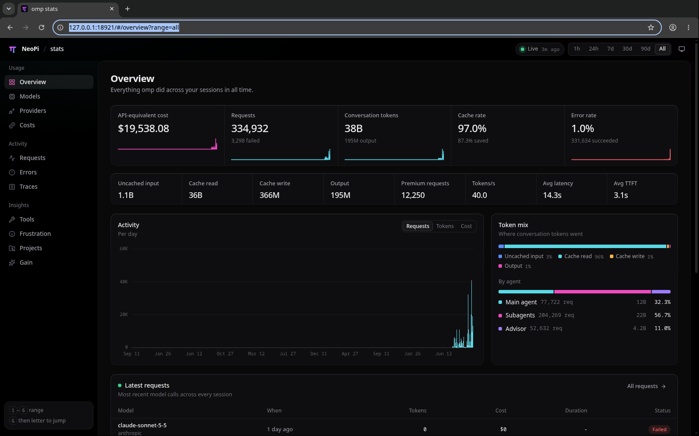

# The Neo design language

NeoDeck is one node in a system whose other nodes are NeoPi's own web
surfaces: `/stats` (the richest), `/collab` (the live viewer) and `/share`
(the transcript export). The owner's order on 2026-10-20 was that NeoDeck and
NeoProxy follow the language those pages already have, "not just the theme
but the design patterns", so that it is visually clear the tools are pieces of
the same whole.

This document is the extracted language. It was built by running the nightly
`npi` binary against a private agent dir, opening `npi stats`, a `/share`
export and the collab viewer in a real Chromium window on an Xvfb display, and
by driving the same pages headlessly to read computed styles, the DOM and the
component inventory. Source files consulted:

- `packages/stats/src/client/styles.css`, `app/Shell.tsx`, `app/nav.ts`, `ui/*`, `traces/*`
- `packages/collab-web/src/styles/tokens.css`, `components/shell/shell.css`, `components/transcript/transcript.css`
- `packages/coding-agent/src/export/html/web-palette.ts`, `template.css`

Screenshots of the references live in `screenshots/neopi-*.png`; the deck's
state before this work is in `screenshots/deck-before-*.png`.

## 1. The one sentence

**A pure-black chassis, one inset panel, hairline edges, and a single
cyan → pink accent.** Everything else is restraint: grey ink ramps, 13 px
controls, 12 px radii, and motion measured in hundreds of milliseconds.

What the owner calls "purple" is the stretch of that accent between cyan and
pink: the NeoPi mark's magenta → iris → cyan gradient, the iris `#945ff9` used
for keywords and thinking, and the purple-tinted black (`#0f0b14`) the share
export sits on. The deck's default theme is named **Neo** and reproduces the
`/stats` palette exactly; **Neo light** is its white-paper twin.



## 2. Tokens

The deck's Tailwind contract (`paper`, `ink`, `line`, `accent`, …) is kept;
Neo maps onto it. Values are RGB triplets so `bg-paper-2/60` keeps working.
The chassis also needs alpha hairlines and a gradient, which triplets cannot
express, so a parallel `--neo-*` set exists for the component layer. The
legacy Paper, Slate and Horizon themes derive their `--neo-*` values from
their own palette, so the shell renders under all five themes.

### Surfaces (one step up per notch)

| Token | Neo | Neo light | Role |
| --- | --- | --- | --- |
| `--paper` / `--neo-bg` | `#000000` | `#f2f2f3` | page |
| `--paper-code` / `--neo-panel` | `#09090a` | `#ffffff` | the one inset panel |
| `--paper-2` / `--neo-card` | `#0e0e10` | `#ffffff` | cards, inputs, table heads |
| `--paper-3` / `--neo-raised` | `#17171a` | `#f6f6f7` | buttons, badges, hover surfaces |
| `--neo-hover` / `--neo-selected` | white 3.5 % / 7.5 % | black 3 % / 6 % | row hover, active nav |

### Hairlines (alpha, so one value reads on every step)

`--neo-line-1` 6 %, `--neo-line-2` 9 %, `--neo-line-3` 14 %, `--neo-line-4`
22 % of white (dark) or black (light). Cards use a **top-lit** border: a
`line-3 → line-1` vertical gradient in the border box, which is what gives the
reference cards their faint lit upper edge.

### Ink

`--ink` `#ededef` · `--ink-2` `#a0a0a8` · `--ink-3` `#6c6c74` · `--ink-4`
`#46464c` (dark). Body copy is `ink`, descriptions `ink-2`, labels and table
heads `ink-3`, dividers in text `ink-4`.

### Accent and status

- `--neo-accent-a` `#5ad8e6` (cyan) → `--neo-accent-b` `#ed4abf` (pink);
  `--neo-accent-gradient` is the 100° blend. Gradient for hero marks, tab
  underlines, meters and the one `accent` button; solid `--accent` `#f068c8`
  for text and strokes.
- `--success` `#3ecf8e` (also `--neo-live`, reserved for real-time presence),
  `--warn` `#f5a524`, `--danger` `#ff6166`, each with a 13 % `-soft` fill.
- `--thinking` `#945ff9` iris: thinking levels, keywords, the "NeoPi" side of
  anything that needs to say "engine".

### Type

- Sans: Inter (variable) with the system stack behind it. 13 px is the control
  size; 13.5 px body in panels; 12.5 px descriptions; 12 px labels; 11.5 px
  badges and micro text.
- Mono: the system monospace stack (`ui-monospace, SF Mono, JetBrains Mono,
  …`). Used for identifiers, numbers in tables (`tabular-nums`), gutters,
  key/value values, kbd hints.
- Scale: page title 22 px / 600 / −0.02 em; card title 14 px / 550; stat
  value 24 px / 550 / −0.025 em; drawer title 15 px / 600.

### Shape and motion

Radii by role: chip 6, control 8, card 12, panel 16, pill 999. Topbar 52 px,
sidebar 224 px, gutter 24–28 px. Easing `cubic-bezier(0.2, 0, 0, 1)` with
`--ease-out` for entrances; durations 120 / 200 / 360 ms. Entrances use
`rise` (6 px lift + fade) with a 40 ms stagger per card.

## 3. The shell

```
┌ topbar (52px, glass: 72 % bg + blur 14px) ─────────────────────────────┐
│ ◆ NeoPi / deck · Page            [status chip] [segmented] [theme] [me] │
├────────────┬───────────────────────────────────────────────────────────┤
│ sidebar    │ ┌ inset panel (radius 16, hairline, shadow-1) ──────────┐ │
│ naked,     │ │ page header: title, description (≤72ch), actions      │ │
│ grouped    │ │ stat grid · cards · tables                            │ │
│ nav, 224px │ │                                                       │ │
│            │ └───────────────────────────────────────────────────────┘ │
│ [foot card]│                                                   8px gap │
└────────────┴───────────────────────────────────────────────────────────┘
```

- **Ambient**: two faint radial gradients (cyan top-left, pink top-right) on
  the page behind everything. It is what makes black feel lit rather than
  dead.
- **Brand lockup**: gradient mark, product name, a thin `/`, then the surface
  name in regular weight (`NeoPi / stats`). The deck is `NeoPi / deck`; the
  current page follows after a second slash.
- **Sidebar**: no border, no background. Groups with a 12 px heading, rows
  32 px tall with a 15 px icon; active row gets the `selected` wash and an
  accent-coloured icon; keyboard hints (`G O`) appear on hover; a small
  footer card holds the shortcut legend. Below 900 px it becomes a
  blurred drawer.
- **Panel**: the content scrolls inside it; it is the only bordered surface at
  shell level.

## 4. Components

| Component | Rules |
| --- | --- |
| Page header | Title + description left, actions right, bottom-aligned. One per page. |
| Card | Top-lit hairline, 12 px radius, `shadow-1`. Header (title, description, actions) → body → footer. `flush` body for full-bleed tables. |
| Stat grid | One card split by inner hairlines, `auto-fit minmax(170px)`. Label 12.5 px ink-2, value 24 px, foot line 12 px ink-3, optional sparkline. |
| Button | 30 px, 13 px/500, raised fill with hairline. Variants: `primary` (inverse ink), `accent` (gradient, one per surface at most), `ghost`, `danger` (soft red). `sm` is 26 px. Icon buttons are square. |
| Input | 30 px, card fill, hairline; cyan focus ring at 18 %. Search = input with a leading icon. |
| Segmented | 2 px padded track, 24 px options, selected wash on the active one. For ranges and view toggles. |
| Tabs | 36 px, underline is the accent gradient. For in-card view switches. |
| Badge | 20 px pill, 11.5 px/500, raised fill; tones ok / warn / bad / accent are soft fills with no border; `planned` is a dashed outline. |
| Dot | 8 px circle; `live` pulses. Green is reserved for presence. |
| Table | 13 px; sticky 12 px ink-3 heads on card fill; 9 px row padding; hairline rows; hover wash; clickable rows get a pointer, selected rows the selected wash. Numbers right-aligned, mono. |
| Empty state | Centred icon (ink-4), title (ink-2/500), hint ≤ 44 ch, 40 px padding. |
| Drawer | Right sheet, 8 px inset from the viewport, 16 px radius, overlay glass with `shadow-3`, slides in 16 px. |
| Key/value grid | `auto-fill minmax(140px)`; key 12 px ink-3 over mono value. |
| Code block | Card fill, hairline, 12 px mono, 480 px max height. |
| Transcript (collab) | 64 px mono gutter, user turns on a raised card, assistant prose flush; tool cards collapsed by default. |

## 5. Do / don't

**Do**

- One accent per surface. If two things glow, neither does.
- Put every page inside the panel; put every list inside a card.
- Say what a number is in words next to it (`3,298 failed`), in ink-3.
- Let empty states explain the next action.
- Keep NeoPi the centrepiece: the brand lockup, the engine status chip and the
  "NeoPi" page carry the gradient; other providers and harnesses get plain
  badges.

**Don't**

- No full-width coloured headers, no borders on the sidebar, no second panel.
- No shouting labels: mono small-caps labels are for gutters and keys, not for
  every form field.
- No uppercase node titles, no rust, no cream.
- Don't use green for anything that isn't live presence or success.
- Don't invent a seventh grey.

## 6. How the deck implements it

- `apps/web/src/styles.css` — the `neo` and `neo-light` token blocks, the
  `--neo-*` chassis tokens, the shared shape/motion tokens and the Neo syntax
  palette.
- `apps/web/src/neo.css` — the component layer (`.neo-card`, `.neo-btn`,
  `.neo-badge`, `.neo-table`, `.neo-stat-grid`, `.neo-nav-row`, …), ported
  measurement for measurement from `/stats`.
- `apps/web/src/components/neo/` — React wrappers (`Card`, `PageHeader`,
  `Stat`, `Badge`, `Button`, `Segmented`, `Empty`, `Construction`).
- `apps/web/src/lib/theme.ts` and `index.html` — Neo is the default; Paper,
  Slate and Horizon remain selectable in Settings → Appearance.

## 7. What the deck looked like before

The inherited deck was a sound structure under the wrong skin: a 48 px icon
rail with no labels, a rust accent on cream or slate, IBM Plex, mono
small-caps labels on every field, and a routine editor whose save bar sat
below the fold. The before shots are kept here so the delta is reviewable:

- `screenshots/deck-before-board.png`
- `screenshots/deck-before-inbox.png`
- `screenshots/deck-before-routines-canvas.png`
- `screenshots/deck-before-routines-steps.png`
